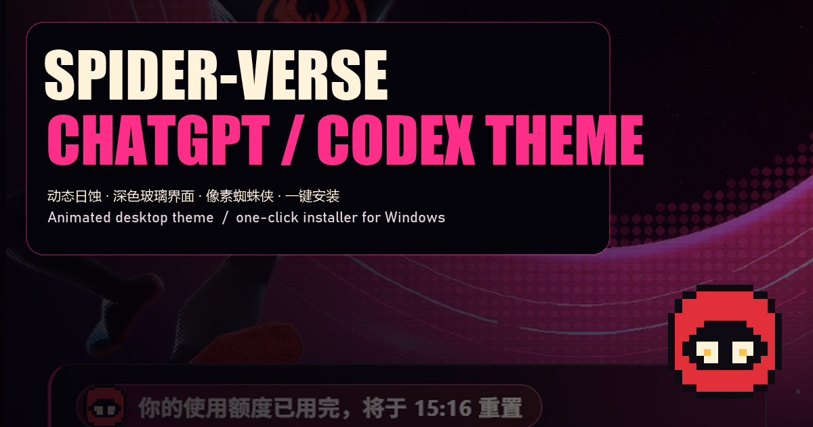
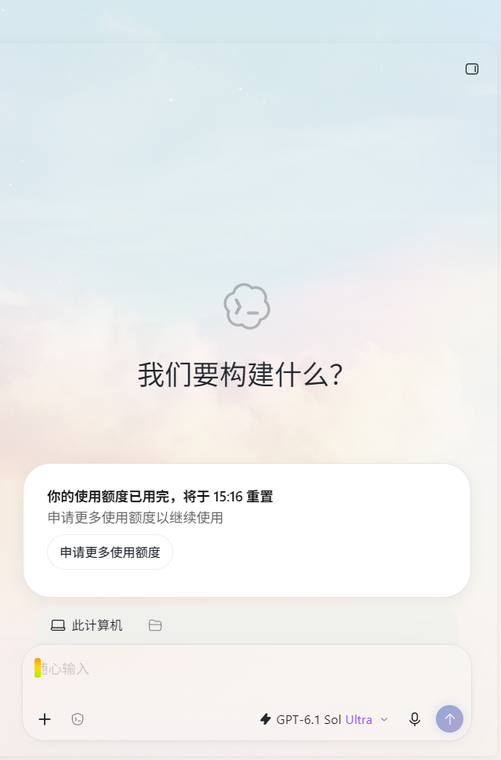
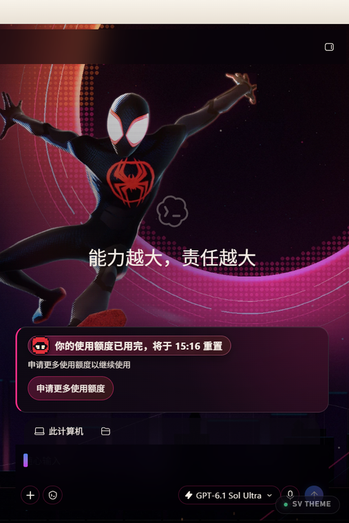
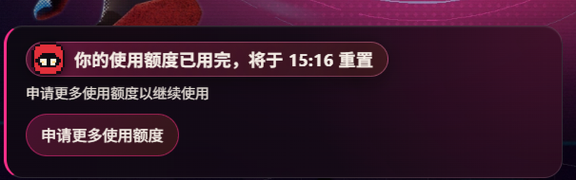

# Spider-Verse Theme for ChatGPT / Codex Desktop

> 把 Windows 版 ChatGPT / Codex 桌面端直接换成「蜘蛛侠：平行宇宙」动态主题。
> 不需要浏览器插件、Python、Node.js，也不修改你的 ChatGPT 账号。
> 一个安装器，双击，等它完成即可。



---

## 这个项目能实现什么？

安装后，你打开 ChatGPT / Codex 桌面端会看到：

- **动态日蚀传送门背景**：Miles 在紫红色日蚀前坠落，Gwen 在左下角登场，城市、光斑、粒子和扫描线持续运动。
- **深色玻璃界面**：侧边栏、主内容区、输入框和卡片变成半透明深色玻璃，文字统一为高对比浅色。
- **更清楚的额度卡**：使用额度提示改为深色高对比卡片；标题变成带像素蜘蛛侠头像的胶囊条；“申请更多使用额度”变成清晰的洋红描边按钮。
- **标题彩蛋**：首页的「我们要构建什么？」替换为 **「能力越大，责任越大」**。
- **像素风装饰**：额度标题左侧和卡片角落使用自绘像素蜘蛛侠，不会糊边。
- **右上角系统按钮可读**：顶部菜单条改为浅色标题栏，最小化 / 最大化 / 关闭落在浅色底上。
- **自动恢复**：ChatGPT 刷新、切页或重启后，后台守护会自动重新注入主题。
- **随时开关**：右下角 `SV THEME` 按钮，或快捷键 `Alt + Shift + S`。

> 这是本地客户端 UI 注入，不是修改你的 ChatGPT 账号，也不会上传聊天内容。

---

## 效果预览

| 原始界面 | 主题界面 |
| --- | --- |
|  |  |

额度卡细节：



---

## 相对原版加了什么？

| 项目 | 原版 ChatGPT / Codex | 本项目 |
| --- | --- | --- |
| 背景 | 浅色云朵渐变 | 动态日蚀 + 布鲁克林夜景 + Miles / Gwen |
| 整体配色 | 浅色 / 深色跟随设置 | 固定深色玻璃 + 洋红 / 青色 / 橙色点缀 |
| 顶部标题栏 | 深色图标在深色底上不明显 | 浅色奶油标题栏，系统按钮改为深色高对比 |
| 额度卡 | 白底浅色卡片，标题不突出 | 深色渐变卡片、独立标题胶囊、像素蜘蛛侠头像 |
| 额度按钮 | 普通文字按钮 | 洋红描边胶囊按钮 |
| 首页标题 | 我们要构建什么？ | 能力越大，责任越大 |
| 装饰 | 无 | 自绘像素蜘蛛侠头像 + 像素小蜘蛛 |
| 持久化 | 无 | 无窗口后台守护，刷新 / 重启自动恢复 |
| 依赖 | 无 | 仅 Windows PowerShell（系统自带），无需 Python / Node / 浏览器扩展 |

---

## 安装（零复杂操作）

> **直接下载：** [SpiderVerse-Codex-Theme-v1.0.0.zip](https://github.com/tblshigg/spider-verse-codex-theme/releases/latest)
>
> 下载后解压，双击 `安装.cmd`，完成。

### 1. 下载

前往本仓库的 **Releases** 页面，下载：

```text
SpiderVerse-Codex-Theme-v1.0.0.zip
```

### 2. 解压

解压到任意文件夹（不要直接在压缩包里运行）。

### 3. 双击

双击 **`安装.cmd`**。

安装器会自动：

1. 复制主题到 `%LOCALAPPDATA%\SpiderVerseCodexTheme`
2. 注册开机自动恢复
3. 创建桌面 / 开始菜单快捷方式 **ChatGPT · Spider-Verse**
4. 启动后台守护
5. 如果 ChatGPT 正在运行，询问是否重启一次以注入主题

如果弹出 Windows SmartScreen，点击 **更多信息 → 仍要运行**。脚本没有签名，但代码全部开源，可自行检查。

### 4. 完成

看到「安装完成」后，从桌面或开始菜单打开 **ChatGPT · Spider-Verse**。

> 以后请用这个快捷方式启动，它会自动带上主题所需的调试参数。
> 直接启动官方原本的 ChatGPT 快捷方式，主题可能不会出现。

---

## 使用

- 右下角 **SV THEME ON**：开启 / 关闭主题
- 快捷键：`Alt + Shift + S`
- 关闭后会记住状态，不会被后台守护强行打开
- 主题会在 ChatGPT 刷新 / 重启后自动恢复
- 建议把 ChatGPT 外观设为深色（Settings → General → Theme → Dark）

---

## 卸载

重新解压下载包，双击 **`卸载.cmd`**。

它会：

- 清理后台守护和开机启动项
- 删除桌面 / 开始菜单快捷方式
- 从正在运行的 ChatGPT 中移除主题
- 删除 `%LOCALAPPDATA%\SpiderVerseCodexTheme`

如果安装包已经删除，也可以手动删除：

```text
%LOCALAPPDATA%\SpiderVerseCodexTheme
%APPDATA%\Microsoft\Windows\Start Menu\Programs\Startup\SpiderVerse Codex Theme.lnk
桌面\ChatGPT · Spider-Verse.lnk
开始菜单\ChatGPT · Spider-Verse.lnk
```

---

## 系统要求

- Windows 10 / 11
- 已安装 **ChatGPT / OpenAI Codex 桌面客户端**
- Windows PowerShell 5.1（系统自带）
- 不需要管理员权限
- 不需要 Python、Node.js、浏览器扩展

测试版本：

```text
OpenAI.Codex 26.1111.2228.0
```

客户端更新可能改变页面结构或调试端口；如果主题失效，欢迎开 Issue 附上截图，我会适配。

---

## 工作原理

1. 安装器把轻量主题脚本放到 `%LOCALAPPDATA%`。
2. 通过 **ChatGPT/Codex 桌面端的本地 DevTools 协议**，在页面里注入一个固定背景层和一组 CSS。
3. 一个无窗口 PowerShell 守护进程每 5 秒检查一次：
   - 如果主题被刷新掉了，自动重新注入；
   - 如果你手动关闭了主题，则尊重 `sv-codex-disabled` 状态，不再强行打开。
4. 不修改安装目录里的原始程序文件，不修改账号数据。

---

## 项目结构

```text
spider-verse-codex-theme/
├─ README.md
├─ LICENSE                  # 仅代码部分 MIT
├─ NOTICE.md                # 素材授权说明
├─ screenshots/
│  ├─ 01-before.png
│  ├─ 02-after.png
│  ├─ 03-quota-card.png
│  └─ 04-before-after.png
└─ installer/
   ├─ 安装.cmd
   ├─ install.ps1
   ├─ 卸载.cmd
   ├─ uninstall.ps1
   ├─ launch.ps1
   ├─ spiderverse.ico
   ├─ payload/
   │  └─ codex_payload.js   # 背景、角色、样式、像素装饰、标题替换
   └─ watcher/
      └─ watcher.ps1        # 无窗口守护，自动恢复
```

---

## 素材与授权（重要）

- **Miles / Gwen 角色透明 PNG** 来自 [PNG All](https://www.pngall.com/)：
  - [Miles Morales](https://www.pngall.com/miles-spider-man-png/download/427647/)
  - [Gwen Stacy](https://www.pngall.com/into-the-spider-verse-png/download/485993/)
- PNG All 的授权为 **免费个人使用、禁止再分发**。本仓库应仓库所有者要求包含这些素材，因此：
  - 仅限个人、非商业使用；
  - 公开下载存在违反素材条款或被下架的风险；
  - 如果你是权利人并希望移除素材，请开 Issue，我会立即处理；
  - 商业使用请自行替换为有授权的素材。
- **像素蜘蛛侠**为本项目自绘的同人像素图。
- Spider-Man / Spider-Verse / Miles Morales / Gwen Stacy 版权归 Marvel / Sony 所有。
- 本项目与 OpenAI、Marvel、Sony、PNG All 均无关联，不销售、不盈利。

代码部分使用 MIT License；第三方角色素材不包含在 MIT 授权内，见 [NOTICE.md](NOTICE.md)。

---

## Credits

- Theme / installer / pixel art：本项目
- Miles & Gwen transparent PNG：[PNG All](https://www.pngall.com/)
- 字体：Windows 自带 Bahnschrift / Impact / Microsoft YaHei UI
- 测试客户端：OpenAI Codex Desktop 26.1111.2228.0

---

## 已知问题 / 反馈

- 客户端更新后，如果某个面板没有变透明或额度卡样式丢失，请开 Issue 并附：
  - 客户端版本
  - 截图
  - `%LOCALAPPDATA%\SpiderVerseCodexTheme\watcher.log`
- 如果系统按钮仍然看不清，请告诉我你的 Windows 主题和缩放比例，我可以继续调整标题栏对比度。

---

**If you like it, star the repo ⭐**
